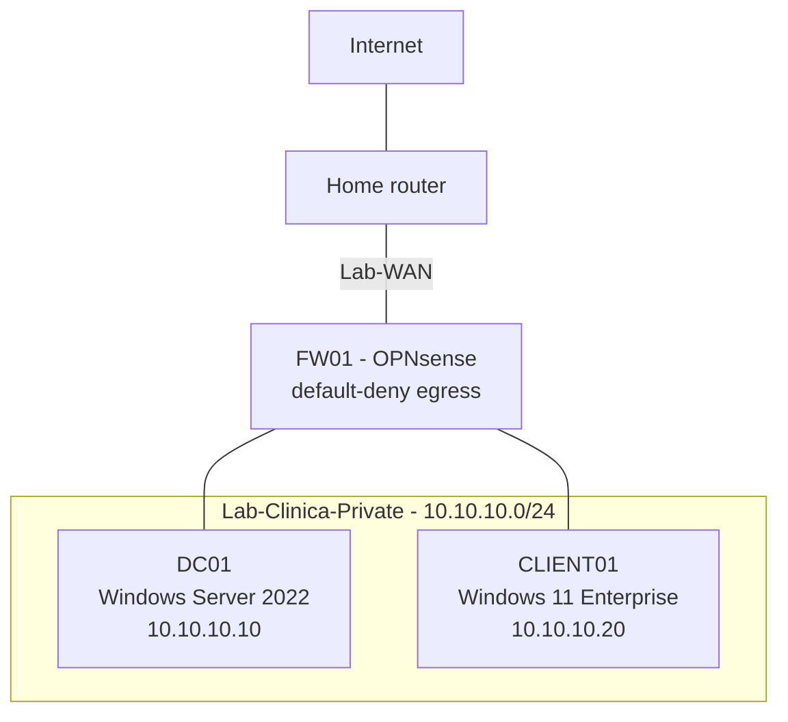

# Azure Hybrid Identity Security Lab

A hands-on lab that takes the on-premises Active Directory domain of a fictional
medical clinic **into the cloud**: hybrid identity with Microsoft Entra ID,
identity protection, cloud security monitoring with Microsoft Sentinel, and a
responsible teardown at the end.

It is the continuation of my previous project,
[active-directory-lab](https://github.com/andreitelea/active-directory-lab),
where the same domain was built, attacked and hardened. The story continues:
**built → attacked → defended → moved to the cloud → defended there too.**

> **Scope & ethics:** all hosts, users and data are fictional. The on-premises
> lab reaches the internet only through a firewall with a default-deny egress
> policy and cannot reach the home network. The goal is defensive learning.

---

## Scenario

**Clinica San Giorgio** is a small outpatient clinic (~20 employees: reception,
doctors, administration) that already runs an Active Directory domain,
`sangiorgio.internal`. It now adopts Microsoft cloud services. Like most real
companies, it keeps its on-premises directory and **synchronizes identities to
Microsoft Entra ID** (hybrid identity). Healthcare data is highly sensitive,
so every step is done with security and auditability in mind.

---

## Architecture (phase 1)

| Host | OS | Role |
|------|----|----|
| **FW01** | OPNsense 26.7 | Firewall / gateway, DNS resolver (Unbound + DNSSEC) |
| **DC01** | Windows Server 2022 (Eval) | Domain Controller + DNS, `sangiorgio.internal` |
| **CLIENT01** | Windows 11 Enterprise 26H2 (Eval) | Domain-joined reception workstation |

Host: Intel i7-12700K, 32 GB RAM, Windows 11 Pro + Hyper-V. Cloud side:
Microsoft Entra ID and an Azure subscription (pay-as-you-go, with cost controls).

---

## Roadmap

- [x] **Phase 1** — On-premises foundation and controlled internet egress
- [ ] Phase 0 — Cost control (budgets and alerts) before creating paid resources
- [ ] Phase 2 — Entra ID tenant: separate cloud admins, break-glass accounts, MFA
- [ ] Phase 3 — Hybrid identity with Entra Cloud Sync
- [ ] Phase 4 — Conditional Access, PIM, Identity Protection
- [ ] Phase 5 — Azure infrastructure security
- [ ] Phase 6 — Microsoft Sentinel (cloud SOC)
- [ ] Phase 7 — Attacks against cloud identities and their detection
- [ ] Phase 8 — Infrastructure as Code
- [ ] Phase 9 — Responsible teardown

---

## Documentation

1. [On-premises foundation & controlled egress](docs/01-on-prem-foundation.md)
2. Entra ID tenant *(in progress)*
3. Hybrid identity *(in progress)*

---

## Key skills demonstrated (so far)

- Firewall design with OPNsense: default-deny egress, aliases, rule ordering, logging
- Secure DNS architecture: AD DNS → forwarder → validating resolver (DNSSEC)
- Reading firewall logs and turning a finding into a hardening action
- Group Policy: LLMNR and NetBIOS disabled domain-wide (anti name-poisoning)
- Safe change management: checkpoints, staged rollout, before/after verification

---

*Author: Andrei Nicolae Telea — [github.com/andreitelea](https://github.com/andreitelea)*
