# 1. On-Premises Foundation & Controlled Egress

This chapter covers **phase 1** of the project: rebuilding the on-premises
environment of Clinica San Giorgio and preparing it for the cloud. The domain
itself comes from my previous project,
[active-directory-lab](https://github.com/andreitelea/active-directory-lab);
what is new here is the network around it.

In the AD lab the network was **fully isolated, with no gateway**. That was
right for an attack lab, but a hybrid identity setup needs the on-premises side
to talk to Microsoft Entra ID over the internet (the Cloud Sync agent in
phase 3). The goal of this phase is therefore:

> Give the lab internet access **without** giving it *unrestricted* internet
> access: only what is needed goes out, everything else is blocked and logged.

## What changed compared to the AD lab

| Area | AD lab | This project |
|------|--------|--------------|
| Internet access | None (isolated, no gateway) | Through a dedicated firewall, **default-deny egress** |
| Firewall | — | **FW01**, OPNsense 26.7 |
| DNS for internet names | — | DC01 forwards to FW01 (Unbound, DNSSEC-validating) |
| Legacy name resolution | NetBIOS and LLMNR enabled (NetBIOS listed as a weakness) | **Both disabled domain-wide via GPO** |
| User accounts | Same temporary password for everyone | Unique temporary passwords, full attributes for cloud sync |
| Admin accounts | — | `OU=Admin`, to be **excluded** from cloud synchronization |

## Network design

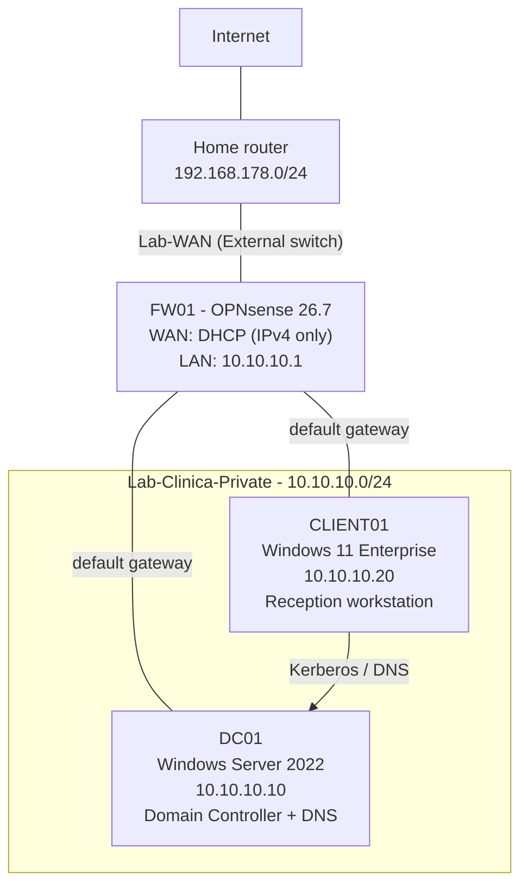

Two Hyper-V virtual switches separate the two worlds:

- **`Lab-WAN`** (External, bound to the host's physical NIC): only FW01's WAN
  interface is connected here. It receives an address from the home router,
  like any other device in the house.
- **`Lab-Clinica-Private`** (Private): FW01's LAN interface, DC01 and CLIENT01.
  The VMs can reach each other, and the **only** way out is through FW01.

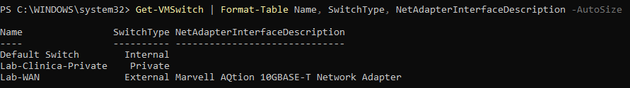

## FW01 – OPNsense firewall

| Setting | Value |
|---------|-------|
| Software | OPNsense 26.7 (updated to 26.7.7), ZFS install |
| VM | Generation 2, Secure Boot **off** (OPNsense is FreeBSD-based and does not boot with Hyper-V Secure Boot) |
| CPU / RAM / Disk | 2 vCPU, 4 GB static, 40 GB |
| WAN (`hn0`) | DHCP from the home router, IPv4 only |
| LAN (`hn1`) | `10.10.10.1/24`, static, **no DHCP server** |
| Checkpoints | Automatic checkpoints off; manual checkpoint before every change |

**Why a real firewall and not just a NAT switch?** Hyper-V's built-in NAT would
give the lab internet access, but with no control over *what* goes out and no
logs. A firewall distribution makes egress policy and logging first-class, which
is exactly what a SOC needs to see.

### Interface assignment: verify by MAC address

On first boot OPNsense assigned the interfaces the **wrong way round**: the LAN
role (with its DHCP server enabled) landed on the NIC connected to the home
network. Left like that, the firewall would have started handing out addresses
on my home LAN.

The fix was to stop trusting names and match the interfaces by **MAC address**:
Hyper-V shows which MAC belongs to which virtual NIC and switch, and the
OPNsense console shows the MAC of `hn0` / `hn1`. The WAN NIC was temporarily
disconnected from the switch (empty `SwitchName` below) while the interfaces
were reassigned, then reconnected.

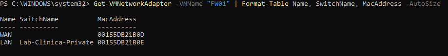

Result: **WAN = `hn0`** (MAC ending `1B:0D`), **LAN = `hn1`** (MAC ending `1B:0E`).

### Initial configuration

| Setting | Value | Reason |
|---------|-------|--------|
| Hostname / domain | `FW01.sangiorgio.internal` | Consistent naming with the AD domain |
| Time zone | Europe/Rome | Firewall logs must line up with Windows event logs |
| DNS | Unbound as a **recursive resolver**, no upstream DNS servers | The firewall resolves names itself instead of trusting a third party |
| DNSSEC | Enabled + *Harden DNSSEC data* | Forged or tampered DNS answers are rejected |
| WAN: *Block RFC1918* / *Block bogons* | Enabled | Drops **inbound** traffic from private and unallocated ranges |
| LAN DHCP server | Disabled | Every host has a static IP; if DHCP is ever needed it belongs on Windows Server, not on the firewall |
| Dnsmasq | Disabled | Enabled by default on the LAN (DNS on port 53053) but unused: an unused service is pure attack surface |
| IPv6 on WAN | Disabled (*IPv6 Configuration Type: None*) | The home router was advertising an IPv6 prefix that the lab does not use |

Two notes I want to state precisely:

- *Block RFC1918* on the WAN only affects traffic **entering** from the WAN. It
  does **not** stop the lab from reaching the home network. That gap is closed
  by the egress rules below.
- After disabling IPv6 on the WAN, the interface still has an IPv6
  **link-local** address (`fe80::…`). This is generated automatically on any
  IPv6-capable interface, is valid only on the local link and cannot be routed,
  so it is not a concern here.

### DNS chain and DNSSEC

Clients never talk to the internet for DNS:

```
CLIENT01 ──> DC01 (AD DNS) ──forwarder──> FW01 (Unbound, DNSSEC) ──> internet root/TLD servers
```

DC01 answers for `sangiorgio.internal` itself and uses FW01 (`10.10.10.1`) as
its **forwarder** for every other name.

DNSSEC validation was tested against `dnssec-failed.org`, a domain whose
signatures are deliberately broken: Unbound must refuse to answer it, while a
correctly signed domain resolves normally.

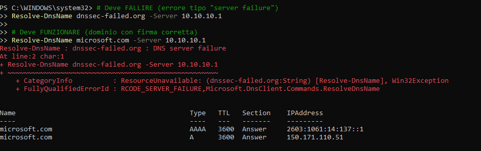

## DC01 and CLIENT01 rebuild

Both machines were rebuilt following chapters 3 and 4 of the
[AD lab](https://github.com/andreitelea/active-directory-lab/tree/main/docs),
with these differences:

- **Default gateway `10.10.10.1`** on both hosts (FW01).
- **Cloud-ready user objects.** `DisplayName`, `Department` and `Title` are
  filled in, because Entra ID will show these attributes after
  synchronization.
- **Unique temporary password per user** (fixes a weakness of the AD lab, where
  every new user had the same one). While creating the users, some passwords
  were rejected by the Default Domain Policy (complexity, or containing the user
  name). `New-ADUser` still creates the account in that case, but **disabled**,
  so those accounts were removed and recreated with compliant passwords.
- **`OU=Admin` stays on-premises only.** It will be excluded from the Cloud
  Sync scope: on-premises admins are not synchronized, and cloud admins will be
  separate, cloud-only accounts (phase 2).
- **UPN suffix left as `@sangiorgio.internal` on purpose.** It is not routable
  on the internet; it will be replaced by a real, verified public domain before
  synchronization.
- **CLIENT01**: Windows 11 Enterprise 26H2, Generation 2 with **vTPM** and
  Secure Boot. Windows Update was run as the *local* administrator, never as a
  Domain Admin. A Domain Admin logging on to a workstation leaves its
  credentials in that machine's memory (see chapter 6 of the AD lab).

## Egress filtering: default deny

### The problem

With OPNsense's default LAN rule (*allow LAN to any*), the lab could reach
**anything**, including the home network. From CLIENT01, the home router's web
interface was reachable:

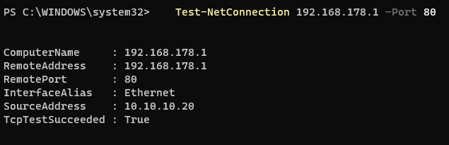

Two more problems followed from the same rule:

- **DNS bypass.** Any host could query any DNS server on the internet,
  skipping Unbound and DNSSEC. DC01 in particular uses root hints when its
  forwarder does not answer, which would silently route around FW01.
- **Unrestricted outbound ports.** Malware on a lab machine could use any port
  to reach its command-and-control server.

### Aliases

Aliases are named, reusable objects. They make rules readable and keep each
value in one place.

| Alias | Type | Content |
|-------|------|---------|
| `RFC1918` | Network(s) | `10.0.0.0/8`, `172.16.0.0/12`, `192.168.0.0/16` |
| `DNS_Ports` | Port(s) | `53` (DNS), `853` (DNS over TLS) |
| `Web_Ports` | Port(s) | `80`, `443` |

### Rules

All rules: interface **LAN**, direction **in**, source **LAN net**, **Quick**
enabled (the first matching rule wins and evaluation stops).

| # | Action | Protocol | Destination | Port | Log | Purpose |
|---|--------|----------|-------------|------|-----|---------|
| 1 | Pass | TCP/UDP | LAN address | `DNS_Ports` | — | DNS only towards FW01 (Unbound) |
| 2 | Pass | ICMP | LAN address | — | — | Ping the gateway for troubleshooting |
| 3 | **Block** | TCP/UDP | any | `DNS_Ports` | ✔ | Close the DNS bypass |
| 4 | **Block** | any | `RFC1918` | — | ✔ | No access to the home LAN or other private networks |
| 5 | Pass | TCP | any | `Web_Ports` | — | Windows Update, Microsoft services, later the Cloud Sync agent |
| 6 | **Block** | any (IPv4 + IPv6) | any | — | ✔ | Everything else, logged |

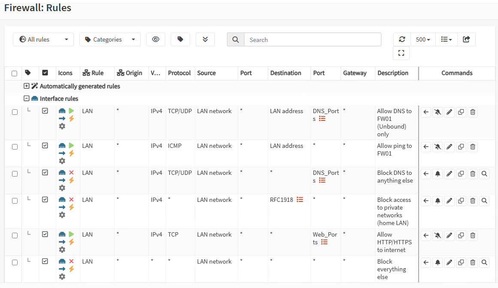

Design choices:

- **Allow-list, then deny everything.** Only three things are allowed: DNS to
  the firewall, ping to the firewall, web traffic to the internet.
- **`LAN address` instead of `This Firewall`.** *This Firewall* includes the WAN
  address too; the LAN only needs to reach `10.10.10.1`.
- **Rule 4 comes before rule 5.** Without it, rule 5 would let the lab reach
  web interfaces on the home network (such as the router itself).
- **Rule 4 does not break the domain.** DC01 ↔ CLIENT01 traffic stays inside
  `10.10.10.0/24` and is switched directly; it never crosses the firewall.
  Access to the firewall's own web GUI is kept by OPNsense's automatic
  **anti-lockout** rule, which is evaluated before these rules.
- **Log the blocks, not the passes.** Blocked attempts are the events worth
  investigating; logging every allowed connection would only add noise.
- **TCP only for web.** Browsers sometimes try QUIC (UDP 443); when it is
  blocked they fall back to TCP automatically.

**Change management.** The new rules were added **while the default
*allow LAN to any* rules were still in place** (above them, so nothing changed
yet), with a VM checkpoint taken first. The default rules were then
**disabled**, everything was verified, and only at the end of the phase were
they **deleted**. At every step there was a one-click way back.

### Verification

| Test (from CLIENT01) | Before | After |
|----------------------|--------|-------|
| `Test-NetConnection 192.168.178.1 -Port 80` (home router) | `True` | **`False`** |
| `Test-NetConnection 1.1.1.1 -Port 443` (internet, HTTPS) | `True` | `True` |
| `Resolve-DnsName microsoft.com` (via DC01 → FW01) | resolves | resolves |
| `Resolve-DnsName microsoft.com -Server 1.1.1.1` (DNS bypass) | resolves | **timeout** |
| From DC01: `Resolve-DnsName login.microsoftonline.com` | resolves | resolves |

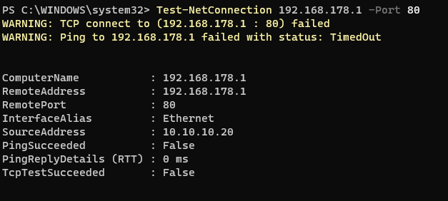

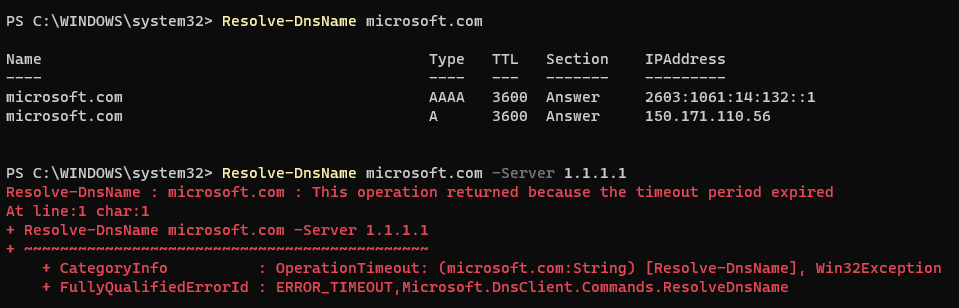

The failures show up as **timeouts** because the rules use *Block* (drop
silently) rather than *Reject*. The client waits and gets no answer at all,
which gives a probing attacker as little information as possible.

Every blocked attempt appears in the firewall log with the **name of the rule**
that stopped it:

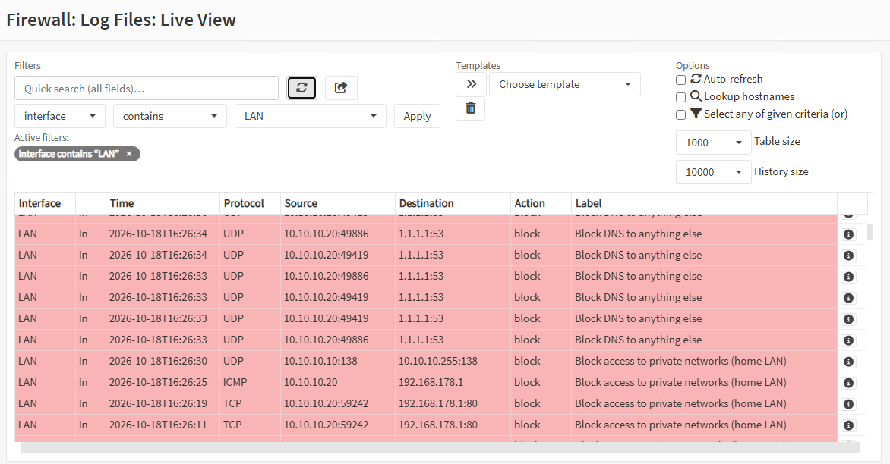

## From the logs to hardening: NetBIOS and LLMNR

### The finding

Among the expected blocks, one entry was not generated by any of my tests:

```
LAN  in  UDP  10.10.10.10:138 -> 10.10.10.255:138  block  "Block access to private networks (home LAN)"
```

This is DC01 sending a **NetBIOS datagram broadcast** (UDP 138) to the whole
subnet. It is harmless to the firewall, and the other hosts receive it directly
from the switch anyway. But it showed that a legacy protocol, already listed as
an open weakness in chapter 3 of the AD lab, was still active on the domain.

### Why it matters

When a Windows machine cannot resolve a name through DNS (a typo, a server that
no longer exists), it falls back to **asking the whole network**:

- **NBT-NS** (NetBIOS Name Service, UDP 137/138), broadcast
- **LLMNR** (Link-Local Multicast Name Resolution, UDP 5355), multicast

**Anyone** on the network can answer those questions. Tools like Responder
answer *"that's me"*. The victim then tries to authenticate to the attacker
and hands over the user's **NetNTLMv2 hash**, which can be cracked offline or
relayed. In a domain with working DNS, neither protocol is needed, so both are
disabled. Disabling only one would leave the same door open through the other.

Note: the domain's NetBIOS *name* (`SANGIORGIO\user` at logon) is stored in
Active Directory and does **not** depend on the NetBIOS protocol, so logons are
not affected.

### Baseline

On DC01 (CLIENT01 showed the same): NetBIOS enabled (`TcpipNetbiosOptions : 0`,
the default with a static IP) and listeners on 137, 138 and 5355.

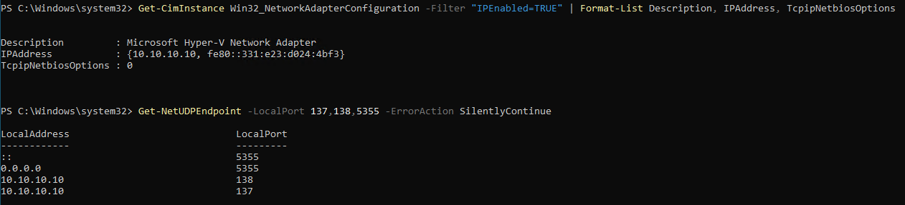

### Implementation: one GPO for the whole domain

A GPO named **`SEC - Disable LLMNR and NetBIOS`**, linked at the domain root,
so it applies to every computer, the Domain Controller included.

**LLMNR** has a native policy setting:

`Computer Configuration → Policies → Administrative Templates → Network → DNS Client → Turn off multicast name resolution` = **Enabled**

**NetBIOS over TCP/IP** has no equivalent setting: it is configured *per
network adapter*. The common approach is a **startup script** delivered by the
GPO. The script is stored in the domain's `NETLOGON` share, readable by every
domain computer:

```powershell
# \\sangiorgio.internal\NETLOGON\Disable-NetBIOS.ps1
# Disable NetBIOS over TCP/IP on all IP-enabled network adapters
Get-CimInstance -ClassName Win32_NetworkAdapterConfiguration -Filter "IPEnabled=TRUE" |
    Invoke-CimMethod -MethodName SetTcpipNetbios -Arguments @{ TcpipNetbiosOptions = [uint32]2 } | Out-Null
```

(`TcpipNetbiosOptions`: `0` = default, `1` = enabled, `2` = disabled.)

It is configured under `Computer Configuration → Policies → Windows Settings →
Scripts → Startup`, on the **Scripts** tab rather than the *PowerShell Scripts*
tab:

| Field | Value |
|-------|-------|
| Script Name | `powershell.exe` |
| Script Parameters | `-NoProfile -ExecutionPolicy Bypass -File \\sangiorgio.internal\NETLOGON\Disable-NetBIOS.ps1` |

Calling `powershell.exe` explicitly makes the behaviour independent of each
machine's execution policy (Windows 11 clients are restrictive by default).
`-ExecutionPolicy Bypass` applies **only to this process**, not to the machine.

Since the GPO contains only computer settings, its **user configuration is
disabled** (GPO Status), so clients skip that part during processing.

### Rollout and verification

Rolled out to **DC01 first, then CLIENT01** (`gpupdate /force` plus a reboot,
since startup scripts only run at boot). If something had gone wrong, it would
have shown up on one machine only.

- `gpresult /r /scope computer` lists the GPO under *Applied Group Policy Objects*.
- `TcpipNetbiosOptions` changed from `0` to **`2`**.
- No process is listening on UDP 137, 138 or 5355 any more.
- Domain logon as `SANGIORGIO\sara.conti` on CLIENT01 still works.

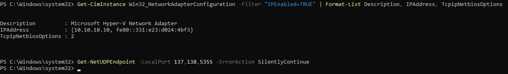

A third protocol, **mDNS** (UDP 5353), can be abused in a similar way; it is
left as a possible follow-up.

## Troubleshooting notes

| Problem | Cause | Fix |
|---------|-------|-----|
| OPNsense LAN role on the home network, with a DHCP server | Automatic interface assignment picked the wrong NIC | Match interfaces by MAC address, reassign, reconnect the WAN |
| `172.16.0.0/12 is not a network` when creating the alias | Value entered incorrectly (not a problem with the network itself) | Retype manually, one network per entry |
| New users created but disabled | Password rejected by the Default Domain Policy; `New-ADUser` still creates the object | Remove and recreate with compliant passwords |
| Rename failed after a successful domain join (`The directory service is busy`) | Join and rename in a single command | Reboot, then `Rename-Computer -DomainCredential` on its own |
| Several commands pasted at once printed a single, incomplete table | PowerShell formats the output using the first object's columns | Run commands one at a time, or use `Format-List` |
| `Add-Computer` executed on DC01 by mistake | Wrong VM window | No damage (*already in that domain*). Lesson: run `hostname` before any impactful command |

## Limitations and what production would add

- **Single firewall.** A real clinic would run a high-availability pair.
- **Firewall management reachable from the whole LAN** (anti-lockout rule). In
  production the GUI would be restricted to a dedicated management network or
  admin workstations.
- **Port-based egress.** Rule 5 allows HTTPS to *any* destination. A stricter
  design would allow only the required Microsoft endpoints (FQDN aliases), or
  force traffic through an inspecting proxy.
- **No IDS/IPS yet.** OPNsense ships with Suricata, which is not enabled in this
  phase.
- **Domain join with a Domain Admin account.** Acceptable in a lab; in
  production, joins are done with a delegated account that can only create
  computer objects in a specific OU.
- **Desktop Experience on the Domain Controller**, chosen for learning, while
  Server Core would reduce the attack surface.
