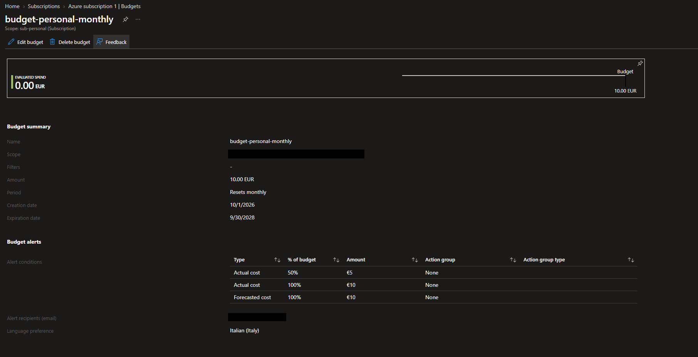
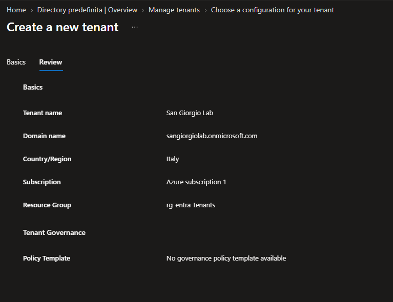
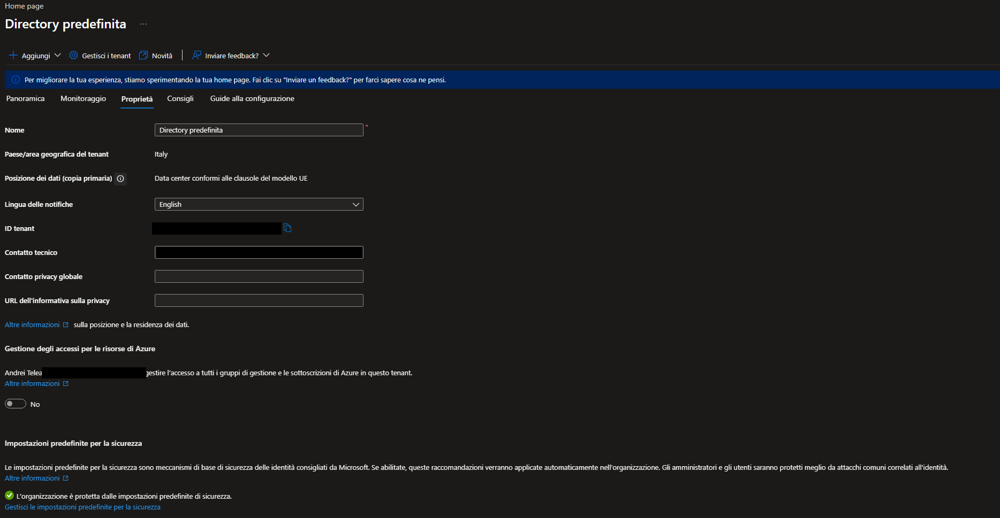
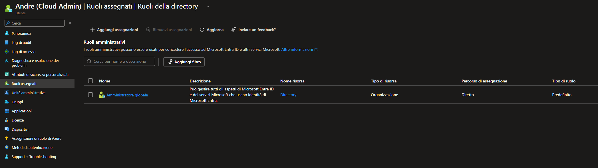
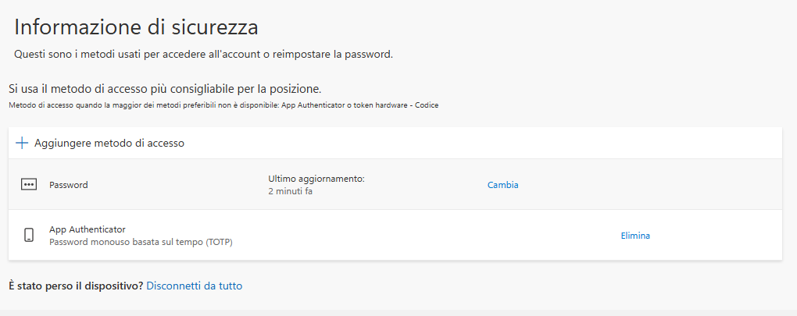
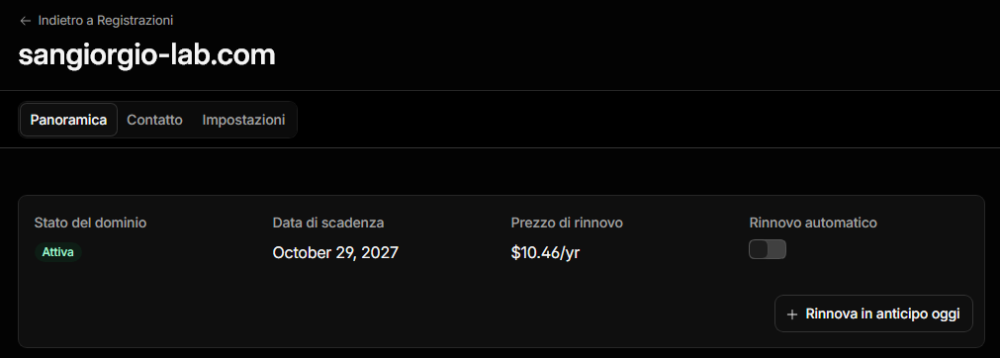
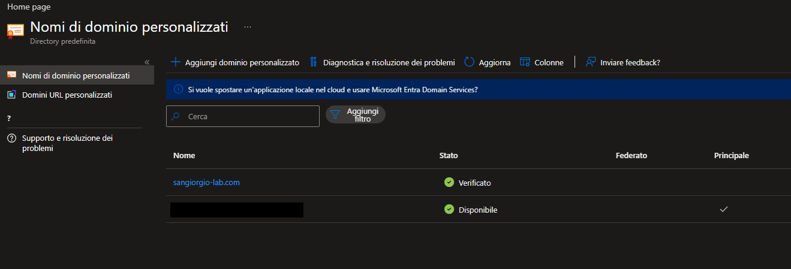
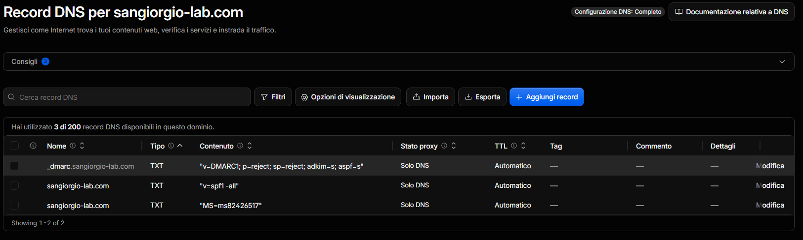

# 2. Entra ID Foundation & Cost Control

This chapter covers **phase 0 and phase 2** of the project. Before anything is
synchronized from the on-premises domain, the cloud side needs a foundation:

> Know what you are paying for, decide *where* the clinic's identities will
> live, give administration its own protected accounts, and prove ownership of
> a real public domain.

Everything in this chapter uses **free** Microsoft Entra ID features. The only
cost is the lab domain (one year, renewal disabled).

## What this phase delivers

| Area | Result |
|------|--------|
| Billing | Pay-as-you-go subscription (`sub-personal`), **Basic** support plan (free) |
| Cost control | Monthly budget with two *actual* alerts and one *forecast* alert |
| Directory | Existing Entra ID tenant, Free tier, data stored in EU datacenters, security defaults on |
| Administration | Separate **cloud-only** admin account, MFA registered |
| Emergency access | Designed and documented; dedicated break-glass accounts left as a stated limitation |
| Public domain | `sangiorgio-lab.com` verified in Entra ID, auto-renew **off** |
| Email anti-spoofing | SPF `-all` and DMARC `p=reject` for a domain that never sends mail |

## Phase 0 – Cost control first

### Upgrading the subscription

The Azure subscription was a free account whose credit had expired, so it was
**disabled**. Creating tenants and, later, Azure resources requires a
pay-as-you-go subscription.

Two checks were done **before** upgrading:

- **The subscription had to be empty.** When a disabled subscription is
  upgraded, any resources left in it are re-enabled and start being billed.
  *All resources* and *Resource groups* both showed nothing.
- **Support plan: Basic (included).** The upgrade page offers paid support plans
  (Developer, Standard, Professional Direct) with a fixed monthly fee. A lab
  does not need them.

After the upgrade the subscription showed *Reactivation in progress* for a
while (renaming it was not possible during that time), then became **Active**.
It was renamed `sub-personal`. This is my general-purpose subscription, not a
lab-only one, so the name says so.

### Budget and alerts

A budget does not stop spending. It **sends an alert** when spending crosses a
threshold. Its value is that a forgotten resource is noticed in days rather than
at the end of the month.

| Setting | Value |
|---------|-------|
| Name | `budget-personal-monthly` |
| Scope | Subscription `sub-personal` (no filters: it covers everything) |
| Amount / period | 10 EUR, resets monthly |
| Alert 1 | **Actual** cost reaches 50 % (5 EUR) |
| Alert 2 | **Actual** cost reaches 100 % (10 EUR) |
| Alert 3 | **Forecasted** cost reaches 100 %, so I get warned *before* the money is spent |
| Recipient | My email address |



One detail worth knowing: opening *Cost Management → Budgets* from the portal
menu defaulted to the **billing profile** scope, and the subscription was not
offered there. Opening *Budgets* from the subscription itself
(*Subscriptions → sub-personal → Cost Management → Budgets*) sets the right
scope.

## Choosing the tenant

### The plan: a dedicated tenant

My Azure account already has a tenant, created automatically with the account.
The original plan was to create a **separate tenant for the clinic**: a clean
environment, separated from my personal one, that could be deleted entirely
at the end of the project.

The portal now offers two tenant types: **Governed Workforce** (employees and
internal resources) and **External** (customer sign-in for apps). Governed
Workforce is the right one. It asks for a subscription and a resource group to
hold a *Microsoft Entra ID Free* billing asset, and it can link the new tenant
to the creating tenant through a governance policy. No policy template existed,
so the new tenant would have been independent.



The creation failed with:

```
Base-tenant <tenant-id> does not have a paid license.
Hence add-on tenant creation is not allowed on this base-tenant.
```

A pay-as-you-go **subscription** is not enough: the base tenant needs a paid,
**license-based** product (for example Entra ID P1/P2 or Microsoft 365).
According to answers on Microsoft Q&A, trial licenses do not qualify; the
official tenant-creation article does not spell this requirement out. Nothing was created, and the empty resource group made
for the billing asset was deleted.

### The decision: use the existing tenant

| Option | Pros | Cons |
|--------|------|------|
| Buy a license, create a dedicated tenant | Clean separation, tenant deleted at teardown | Entra ID P1 is sold as an annual subscription: a yearly cost only to unlock tenant creation |
| **Use the existing tenant** ✔ | Free, available now, subscription already linked | Teardown means removing objects one by one; the initial `.onmicrosoft.com` domain is derived from my personal email |

Every feature planned for this project works the same way in the existing
tenant, so I chose it. The consequences are handled explicitly:

- The initial `.onmicrosoft.com` domain is **redacted** in all screenshots, and
  the lab uses its own verified domain for identities.
- The teardown chapter will list every object to remove (synchronized users,
  sync configuration, policies, cloud admin) instead of deleting a tenant.

### Baseline

Before changing anything, I recorded the starting state of the directory: one
user (my own account, Global Administrator), no groups, no applications, no
devices, **Entra ID Free**.



- **Country: Italy, data in EU datacenters.** For a healthcare scenario, where
  identity data is stored matters.
- **Security defaults: enabled.** This is Microsoft's free baseline: it requires
  MFA registration for all users and blocks legacy authentication. It stays on
  until phase 4, where it is replaced by Conditional Access policies (the two
  cannot be used together).

## A separate cloud administrator

### Why

Until now the only administrator was my personal Microsoft account. In a real
organization that is wrong for two reasons:

1. **Separate admin accounts.** The account used for email and browsing is the
   one most exposed to phishing. Administration is done with a dedicated
   account that does nothing else.
2. **Cloud-only admins.** An admin account synchronized from Active Directory
   inherits AD's risks: whoever compromises the on-premises domain (as in the
   [AD lab](https://github.com/andreitelea/active-directory-lab)) can reset
   that password and take over the cloud too. Cloud admin accounts are therefore
   created **directly in Entra ID**, and `OU=Admin` will be excluded from
   synchronization in phase 3.

### Configuration

| Setting | Value |
|---------|-------|
| User principal name | `adm.andre@<initial-domain>.onmicrosoft.com` |
| Display name | `Andre (Cloud Admin)` |
| Type | Member, cloud-only |
| Password | Generated by Entra ID, changed at first sign-in, stored in a password manager |
| Role | **Global Administrator** (direct assignment) |

The name matches the on-premises convention (`adm.andre` in `OU=Admin`). There
is no conflict because the on-premises account will never be synchronized.



**Global Administrator is temporary.** It is needed to set up synchronization
and Conditional Access in the next phases. In phase 4, **Privileged Identity
Management** will make the role *eligible* instead of permanent: the account
will hold it only when activated, for a limited time.

### MFA

Microsoft enforces MFA for every account that signs in to the Azure portal and
the Entra and Intune admin centers, and, with a rollout that started in October 2025, for Azure CLI,
PowerShell and infrastructure-as-code tools. There is no opt-out. The first
sign-in of `adm.andre` (in a private browser window, to keep it separate from
my personal session) therefore required a password change and MFA
registration.



The method registered is **Microsoft Authenticator with a time-based code
(TOTP)**. It meets the MFA requirement but is **not phishing-resistant**: a
fake login page can relay the code in real time. Moving admins to a
phishing-resistant method (passkeys) is part of the authentication-method work
in phase 4.

## Emergency access ("break-glass")

### Microsoft's guidance

Microsoft recommends at least **two emergency access accounts**: cloud-only,
**permanently** assigned Global Administrator (not eligible through PIM),
excluded from Conditional Access policies that could lock everyone out, with a
**phishing-resistant** method (FIDO2 passkey or certificate-based
authentication) **different from the one used by normal admins**, an alert on
**every** sign-in, credentials stored in separate safes, and a test at least
every 90 days. Mandatory MFA applies to these accounts too.

### What this lab does

Meeting that guidance properly requires hardware security keys. Creating
break-glass accounts protected by the same phone as `adm.andre` would add
accounts without adding resilience: losing the phone would lock out all of
them.

For a single-administrator lab, the **original account that created the
directory** acts as the emergency account:

- it keeps **permanent** Global Administrator;
- it uses a different authentication path from `adm.andre` (a personal
  Microsoft account with its own security settings);
- in **phase 4** it will be excluded from every Conditional Access policy that
  can block sign-in;
- in **phase 6** Microsoft Sentinel will raise an alert on every sign-in of this
  account, which is the detection Microsoft recommends for break-glass accounts.

This is a documented compromise, listed again under *Limitations* below.

## A public domain for the lab

### Why a domain is needed

On-premises users have UPNs such as `sara.conti@sangiorgio.internal`. The
`.internal` suffix cannot be routed or verified on the internet. Without a
verified domain, synchronized users would sign in with
`@<initial-domain>.onmicrosoft.com`. A real organization signs in with its own
domain, so the lab gets one.

The domain must **not** look like a real clinic (there are real healthcare
facilities named San Giorgio), so it says what it is: **`sangiorgio-lab.com`**.

### Registration

| Setting | Value | Reason |
|---------|-------|--------|
| Registrar | Cloudflare Registrar | At-cost pricing, DNS included, WHOIS contact data redacted by default |
| TLD | `.com` | Cloudflare does not register `.it` |
| Term | 1 year | The domain only lives as long as the project |
| Auto-renew | **Off**, verified after purchase | No forgotten renewal |
| Account security | MFA on the Cloudflare account | Whoever controls the DNS controls the domain's verification in Entra ID |



At the end of the project the domain will be **removed from Entra ID before it
expires** and then left to lapse.

### Verification in Entra ID

Entra ID does not take ownership on trust. It issues a random value that must be
published in the domain's DNS: only whoever controls the DNS can do that.

1. *Entra ID → Domain names → Add custom domain* → `sangiorgio-lab.com`
2. Entra ID returns a TXT record: host `@`, value `MS=ms…`
3. The record is created in Cloudflare DNS
4. *Verify* → **Verified** within seconds



The domain is **verified but not primary**. It will be used as the UPN suffix
for synchronized users in phase 3.

### SPF and DMARC for a domain that never sends email

A domain without email is still a spoofing target: anyone can write
`billing@sangiorgio-lab.com` in the *From* field of a phishing email. Two DNS
records tell receiving mail servers to reject such messages:

| Record | Name | Value | Meaning |
|--------|------|-------|---------|
| SPF | `@` | `v=spf1 -all` | No server is authorized to send mail for this domain |
| DMARC | `_dmarc` | `v=DMARC1; p=reject; sp=reject; adkim=s; aspf=s` | Reject mail that fails the checks, also for subdomains, with strict alignment |



- **`sp=reject`** extends the policy to subdomains (for example a spoofed
  `invoices.sangiorgio-lab.com`).
- **No `rua=` reporting address.** The domain has no mailbox to receive DMARC
  reports. A production domain would collect them to see who is trying to spoof
  it.
- **No DKIM.** DKIM signs outgoing mail; a domain that sends nothing has nothing
  to sign.

## Troubleshooting notes

| Problem | Cause | Fix |
|---------|-------|-----|
| Subscription *Rename* greyed out | Subscription still in *Reactivation in progress* after the upgrade | Wait until it is **Active** |
| Budget scope shows only my name, no subscription | *Cost Management* opened at **billing profile** scope | Open *Budgets* from the subscription itself |
| `Base-tenant … does not have a paid license` | Creating an extra workforce tenant requires a paid license-based product in the base tenant; a pay-as-you-go subscription is not enough | Use the existing tenant (see *Choosing the tenant*) |
| Tenant creation asks for a resource group, none exists | The *Governed Workforce* wizard only lists existing resource groups | Create one first; deleted again after the failed attempt |

## Limitations and what production would add

- **No dedicated break-glass accounts.** Production: two cloud-only accounts
  with FIDO2 security keys stored in separate safes, excluded from Conditional
  Access, alert on every sign-in, tested every 90 days.
- **Shared tenant.** The lab lives in my existing tenant instead of a dedicated
  one, so the teardown removes objects one by one.
- **Admin MFA is not phishing-resistant** (TOTP). Production admins would use
  passkeys or certificate-based authentication, enforced through
  authentication strengths in Conditional Access (phase 4).
- **Permanent Global Administrator** on the cloud admin until PIM is introduced
  in phase 4.
- **Budget alerts are notifications only.** Nothing stops spending
  automatically. Production environments add automated actions through action
  groups, or policies that restrict what can be created.
- **DMARC without reporting.** Production domains collect aggregate reports
  (`rua=`).

**Next:** phase 3, hybrid identity. The Entra Cloud Sync agent on the
on-premises side, the UPN suffix moved to `sangiorgio-lab.com`, and
`OU=Admin` kept out of the cloud.
