# 3. Hybrid Identity with Entra Cloud Sync

This chapter covers **phase 3**: connecting the clinic's Active Directory to
Microsoft Entra ID. After this phase each employee has **one identity and one
password**, used both for the domain-joined workstation and for cloud services.

> Synchronize only what belongs in the cloud, keep administrators out of it,
> and protect the server that does the synchronization as carefully as a
> domain controller.

## What this phase delivers

| Area | Result |
|------|--------|
| Sync engine | **Microsoft Entra Cloud Sync**, provisioning agent on a dedicated server, **SYNC01** |
| Placement | SYNC01 treated as **Tier 0** and placed in `OU=Tier0-Servers` under `OU=Admin` |
| Sign-in names | UPN suffix moved from `sangiorgio.internal` to the verified `sangiorgio-lab.com` |
| Scope | Only the `Utenti` and `Gruppi` OUs; **`OU=Admin` is not synchronized** |
| Passwords | **Password Hash Sync**, proven with a password changed only in AD |
| Safety net | Accidental-deletion prevention, threshold 3 |
| SYNC01 hardening | Windows LAPS, logon restricted to administrators, **incoming NTLM denied** |
| Workstations | Windows LAPS on CLIENT01; the static local admin account removed |

## Architecture

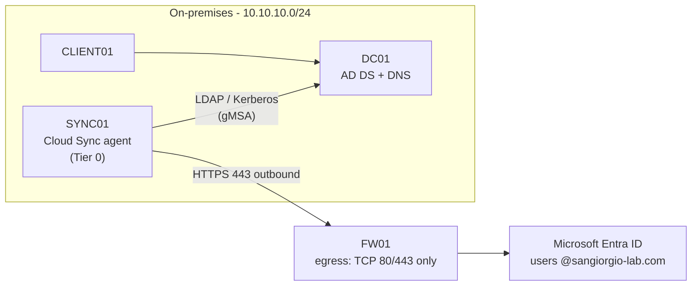

Cloud Sync is Microsoft's newer, lightweight alternative to the traditional
Entra Connect Sync server: the agent only makes **outbound** HTTPS connections, and the
synchronization logic and configuration live in the cloud. The egress policy
built in chapter 1 (TCP 80/443 to the internet, everything else blocked) was
designed with this agent in mind, and it was enough. No firewall change was
needed.

## Design decision: a dedicated sync server

Microsoft supports installing the agent **on a domain controller** or on a
**member server**, and recommends hardening that server as a **Control Plane
(Tier 0)** asset: whoever controls it can manipulate users in Entra ID.

| Option | For | Against |
|--------|-----|---------|
| Agent on DC01 | Supported; no new Tier 0 machine | Extra software on the domain controller |
| **Dedicated SYNC01** ✔ | Separation of roles, as in most companies; room to show Tier 0 hardening | One more server to build and protect |

Microsoft also recommends **three agents** for high availability. The lab runs
one (see *Limitations*).

## SYNC01

Built from PowerShell on the Hyper-V host, so the configuration is documented
and repeatable:

```powershell
New-VM -Name SYNC01 -Generation 2 -MemoryStartupBytes 4GB -Path "E:\Lab\Hyper-V" `
       -NewVHDPath "E:\Lab\Hyper-V\SYNC01\SYNC01.vhdx" -NewVHDSizeBytes 60GB -SwitchName "Lab-Clinica-Private"
Set-VMMemory   -VMName SYNC01 -DynamicMemoryEnabled $false   # the agent needs at least 4 GB
Set-VMProcessor -VMName SYNC01 -Count 2
Set-VMKeyProtector -VMName SYNC01 -NewLocalKeyProtector
Enable-VMTPM   -VMName SYNC01
Set-VM -Name SYNC01 -AutomaticCheckpointsEnabled $false
```

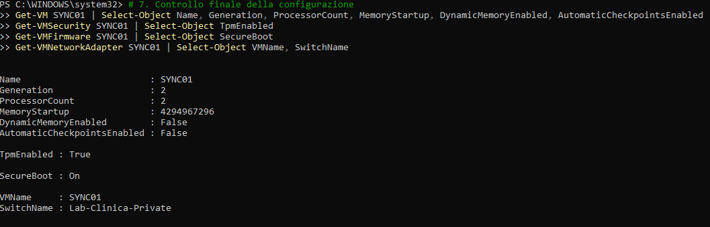

| Setting | Value | Reason |
|---------|-------|--------|
| OS | Windows Server 2022 Standard, **Desktop Experience** | The agent does not support Server Core |
| Memory | 4 GB **static** | Documented minimum; dynamic memory could drop below it |
| IP / gateway / DNS | `10.10.10.30` / FW01 / **DC01** | Static address; DNS must be AD DNS to find the domain |
| Updates | Installed as the **local** administrator | No Domain Admin logon just to patch a server |
| Domain join | Straight into `OU=Tier0-Servers` with `Add-Computer -OUPath` | The computer object never sits in the default `Computers` container |

```powershell
Add-Computer -DomainName sangiorgio.internal `
             -OUPath "OU=Tier0-Servers,OU=Admin,OU=Clinica,DC=sangiorgio,DC=internal" `
             -Credential SANGIORGIO\adm.andre -Restart
```

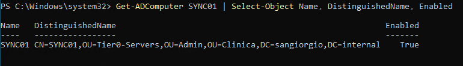

Keeping Tier 0 servers in their own OU has two effects: stricter GPOs can be
linked there (done below), and since the OU is under `OU=Admin` it stays
**outside** the synchronization scope.

## Preparing Active Directory

### A routable UPN suffix

The users' UPNs ended in `@sangiorgio.internal`. That suffix cannot be verified
in Entra ID, so synchronized users would have received
`@<initial-domain>.onmicrosoft.com` names. The domain verified in chapter 2
was added as a UPN suffix for the forest, and only the clinic's users were moved
to it:

```powershell
Set-ADForest -Identity sangiorgio.internal -UPNSuffixes @{Add="sangiorgio-lab.com"}

$utenti = (Get-ADOrganizationalUnit -Filter 'Name -eq "Utenti"').DistinguishedName
Get-ADUser -SearchBase $utenti -Filter * | ForEach-Object {
    Set-ADUser $_ -UserPrincipalName ("{0}@sangiorgio-lab.com" -f $_.SamAccountName)
}
```

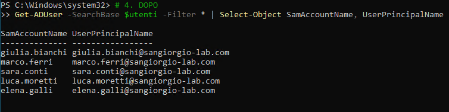

- `sAMAccountName` is unchanged, so `SANGIORGIO\sara.conti` logons keep
  working.
- The on-premises `adm.andre` in `OU=Admin` keeps its `@sangiorgio.internal`
  UPN on purpose: it is never synchronized.
- A checkpoint of DC01 was taken before the change.

With five cleanly created users there was nothing for **IdFix** (Microsoft's
tool for finding duplicates and invalid characters before synchronization) to
find. In a real directory it is the first step.

### AD site and agent prerequisites

| Check | Result |
|-------|--------|
| Subnet `10.10.10.0/24` linked to the AD site | Created (`New-ADReplicationSubnet`), as Microsoft requires for agent servers |
| .NET Framework ≥ 4.7.1 | 4.8 (`Release` 528449) |
| PowerShell execution policy | `RemoteSigned` |
| TLS 1.2 | Explicitly enabled (SCHANNEL client/server keys, `SchUseStrongCrypto`) before installing |
| Outbound HTTPS from SYNC01 | `Test-NetConnection login.microsoftonline.com -Port 443` → `True` through FW01 |
| KDS root key (needed for the gMSA) | Checked with `Get-KdsRootKey` before installing. In a single-DC **lab** it can be created with an effective time 10 hours in the past; in production `-EffectiveImmediately` is used and AD waits up to 10 hours before allowing gMSAs |

## Installing the agent

The agent was downloaded from *Entra ID → Entra Connect → Cloud Sync → Agents*
and installed on SYNC01, signed in as the on-premises domain admin.

1. **Sign in to Entra ID** with the cloud-only admin from chapter 2 (the
   *Hybrid Identity Administrator* role is the minimum required).
2. **Service account**: *Create gMSA*. The wizard creates
   `SANGIORGIO\provAgentgMSA$`, a group managed service account whose password
   is generated and rotated by AD and is never known to anyone.
3. **Connect Active Directory**: `sangiorgio.internal`.

The sign-in window was blocked by **Internet Explorer Enhanced Security
Configuration**. Instead of turning ESC off, only the Microsoft sign-in domains
it blocked (such as `aadcdn.msftauth.net`) were added to *Trusted sites*. ESC
stays on for everything else.

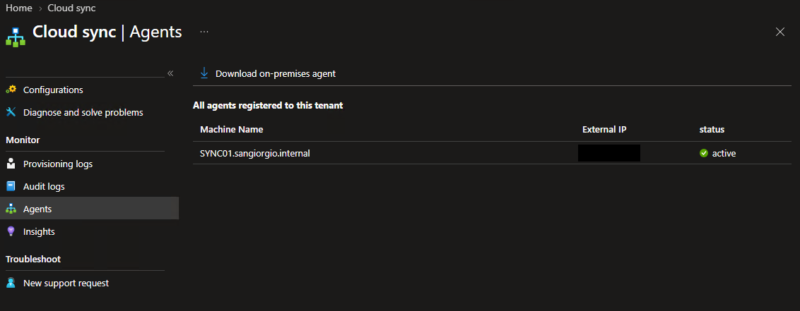

## Sync configuration

**Entra Connect → Cloud Sync → New configuration → AD to Microsoft Entra ID sync**

| Setting | Value | Reason |
|---------|-------|--------|
| Domain | `sangiorgio.internal` | |
| Password hash sync | **On** | One password for on-premises and cloud |
| Scope | **Selected OUs**: `OU=Utenti` and `OU=Gruppi` | Users and their groups only; `OU=Admin` (admins and Tier 0 servers) stays on-premises |
| Prevent accidental deletions | **On**, threshold **3**, email notification | With 5 users, 3 deletions at once is an anomaly (mistake or attack in AD): the job stops instead of deleting cloud accounts too |

**Test before enabling.** *Provision on demand* runs the configuration for a
single object. It was used on `sara.conti`, whose account sits in a **child**
OU (`Utenti\Reception`), to confirm that child OUs are included in the scope.

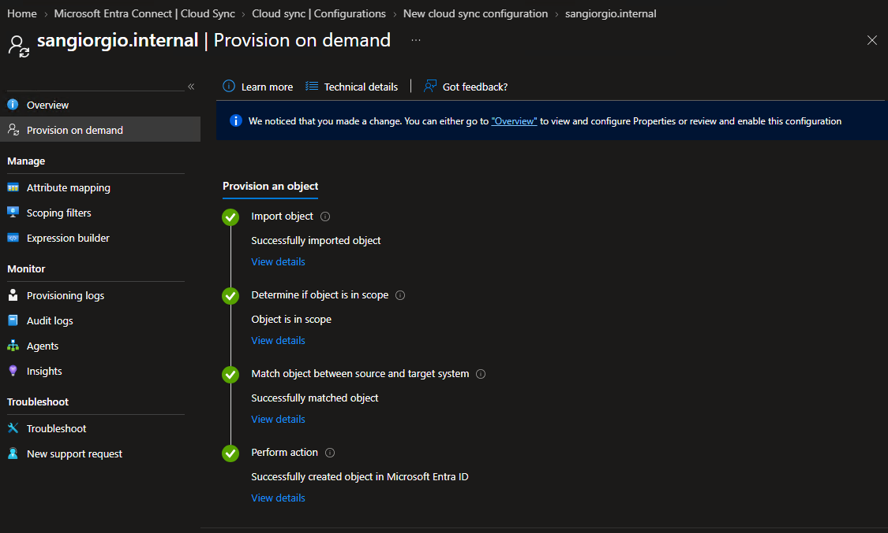

Only after that test was the configuration **enabled**.

### Result

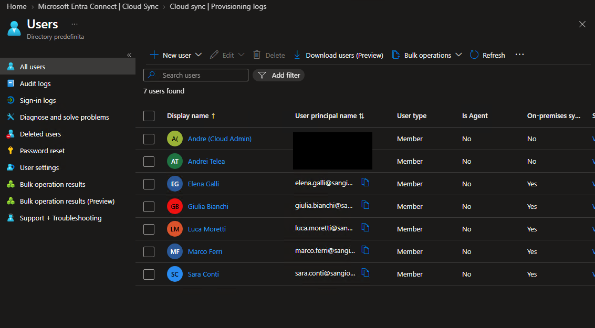

- The **5 clinic users** appear with `@sangiorgio-lab.com` UPNs and
  *On-premises sync = Yes*.
- The two **cloud-only** accounts from chapter 2 show *On-premises sync = No*:
  they are independent of AD.
- The on-premises **`adm.andre` is absent**, so the `OU=Admin` exclusion works.
- The groups `GRP-Amministrazione`, `GRP-Medici` and `GRP-Reception` were
  synchronized as security groups.

### Proving Password Hash Sync

Seeing the accounts in the cloud does not prove the password works there. The
test:

1. Reset `sara.conti`'s password **only in Active Directory** (on DC01).
2. Wait a couple of minutes.
3. Sign in to `myaccount.microsoft.com` as `sara.conti@sangiorgio-lab.com` with
   the new password.

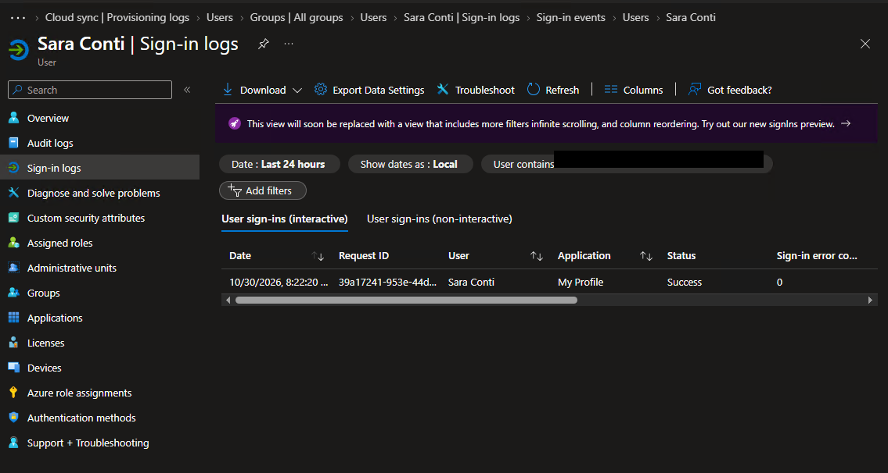

The **interactive** sign-in log shows the evidence: a password sign-in with
the new password succeeded. The non-interactive log only shows token
refreshes that happen after a sign-in.

## Hardening SYNC01 as a Tier 0 server

Microsoft's prerequisites for the agent include hardening its server like a
domain controller: restrict administrative access, use unique local admin
passwords (Windows LAPS), deny NTLM, and avoid day-to-day activity such as web
browsing. Each measure below was applied with a checkpoint first and a
before/after test.

### 1. Windows LAPS

**Problem.** A local Administrator password that is the same on many machines,
or never changes, turns one compromised machine into many (lateral movement,
pass-the-hash).

**Fix.** Windows LAPS (built into Windows) gives each machine a long random
password for its built-in Administrator, rotates it, and stores it
**encrypted** in AD, where only Domain Admins can decrypt it.

```powershell
Update-LapsADSchema                                       # one-time, forest-wide
Set-LapsADComputerSelfPermission -Identity $tier0         # OU=Tier0-Servers
Set-LapsADComputerSelfPermission -Identity $postazioni    # OU=Postazioni
Find-LapsADExtendedRights -Identity $tier0                # only SYSTEM and Domain Admins
```

- **Schema change.** `Update-LapsADSchema` failed with *insufficient access
  rights*: changing the schema requires **Schema Admins**, not Domain Admins.
  The admin account was added to Schema Admins **only for the change** (sign
  out and in, because group membership is read at logon), then removed. The
  group is back to its default member only.
- **Encryption** requires a domain functional level of 2016 or later. The domain
  is at `Windows2016Domain`.

GPO **`SEC - Windows LAPS`**, linked to `Tier0-Servers` and `Postazioni`
(*Computer Configuration → Policies → Administrative Templates → System → LAPS*):

| Setting | Value |
|---------|-------|
| Configure password backup directory | Active Directory |
| Password Settings | Upper + lower case + numbers + special characters, length **20**, age **30** days |
| Enable password encryption | Enabled |

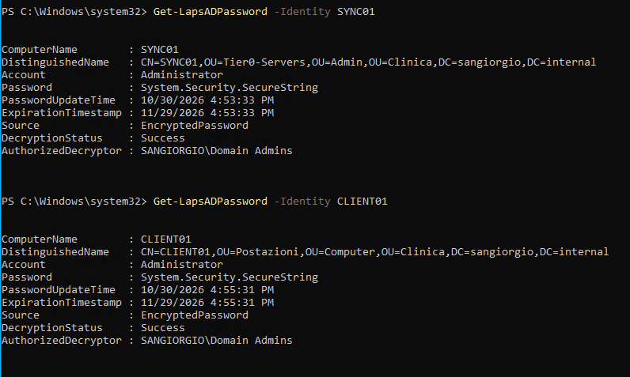

**Verified in practice, not only on paper.** On CLIENT01 the local admin used
for patching in chapter 1 was a separate account, `localadmin`, with a
hand-picked static password that LAPS does not manage. The built-in
Administrator was enabled, used **once** with the password read from AD, and
`localadmin` was deleted. Because the password had been displayed in clear
text, it was immediately rotated with `Reset-LapsPassword`. The new
`PasswordUpdateTime` in AD confirmed it.

### 2. Logon restricted to administrators

**Before:** a normal domain user (`sara.conti`) could sign in at the SYNC01
console. Member servers allow local logon to *Users* by default.

GPO **`SEC - Tier0 Server Hardening`**, linked to `Tier0-Servers`
(*… Local Policies → User Rights Assignment*):

| Right | Value |
|-------|-------|
| Allow log on locally | `BUILTIN\Administrators` only |
| Allow log on through Remote Desktop Services | `BUILTIN\Administrators` only |

On a member server, the local Administrators group contains the LAPS-managed
local Administrator and Domain Admins.

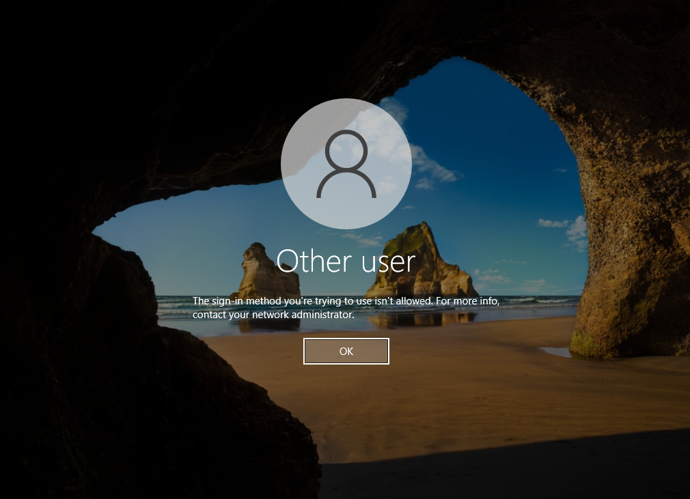

A detail worth knowing: Hyper-V's **enhanced session** (copy/paste, dynamic
resolution) is a Remote Desktop session. The "before" test therefore had to be
done in a **basic session** to test console logon rather than the RDP right.

### 3. Incoming NTLM denied

**Why.** NTLM is the legacy authentication protocol behind pass-the-hash and
NTLM relay attacks. Kerberos uses tickets tied to service **names**. Denying
incoming NTLM means a network logon to SYNC01 must use Kerberos.

**Test design.** Connecting to `\\SYNC01.sangiorgio.internal\c$` uses Kerberos.
Connecting to `\\10.10.10.30\c$` cannot use Kerberos (no ticket for an IP
address), so Windows falls back to NTLM. After the change, the first must still
work and the second must fail.

**Firewall first.** The test initially failed both ways because SMB (TCP 445)
is **closed by default** on SYNC01, which is the right state for a Tier 0
server. For the test only, a temporary rule allowed TCP 445 **from DC01 only**,
named so that its purpose was obvious, and it was removed afterwards:

```powershell
New-NetFirewallRule -DisplayName "TEMP - SMB from DC01 for NTLM test" -Direction Inbound `
  -Protocol TCP -LocalPort 445 -RemoteAddress 10.10.10.10 -Profile Domain -Action Allow
# ... tests ...
Remove-NetFirewallRule -DisplayName "TEMP - SMB from DC01 for NTLM test"
```

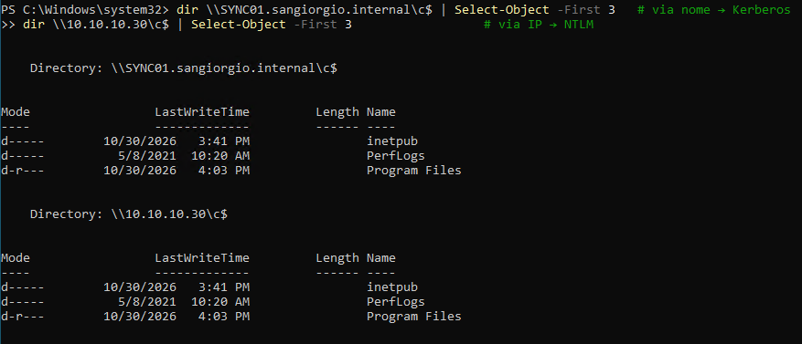

Settings added to `SEC - Tier0 Server Hardening` (*… Local Policies → Security
Options*):

| Setting | Value |
|---------|-------|
| Network security: Restrict NTLM: Audit Incoming NTLM Traffic | Enable auditing for all accounts |
| Network security: Restrict NTLM: Incoming NTLM traffic | **Deny all accounts** |

In production, auditing runs **alone** for a while to find out who still uses
NTLM, and the deny comes later. SYNC01 is a new server whose only connections
(agent → cloud over HTTPS, agent → DC with Kerberos) do not involve incoming
NTLM, so both were applied together.

The first "after" test still succeeded: the SMB session opened during the
"before" test was being **reused**. After closing the sessions
(`Get-SmbSession | Close-SmbSession -Force` on SYNC01, `net use * /delete` on
DC01), the result was the expected one:

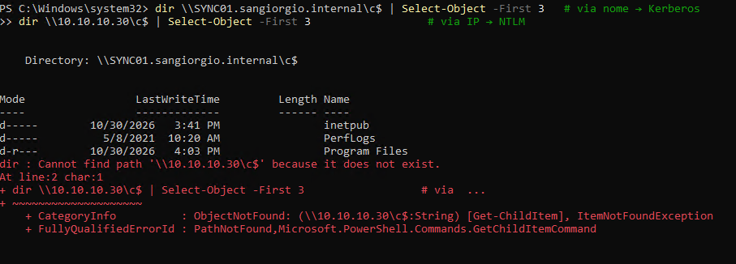

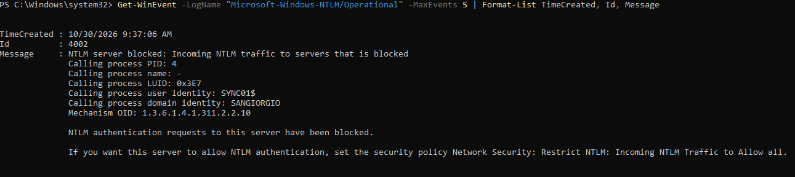

After all three measures the agent remained **active** in the portal.

## Troubleshooting notes

| Problem | Cause | Fix |
|---------|-------|-----|
| DNS timeout from SYNC01 to the domain | DC01 was powered off | Start DC01 (and FW01) first; the lab has a start order |
| Agent sign-in window blank / blocked | IE Enhanced Security Configuration | Add only the Microsoft sign-in domains to Trusted sites |
| `Update-LapsADSchema`: insufficient access rights | Schema changes need **Schema Admins** | Temporary membership, sign out/in, remove afterwards |
| Still no Schema Admins after adding the account | Group membership is read at logon; `findstr` with a space matched *Domain **Admins*** | Sign out and in; search with `findstr /c:"Schema Admins"` |
| Console logon test hit the RDP right | VMConnect enhanced session is RDP | Use a basic session for console tests |
| `\\SYNC01\c$` unreachable both ways | SMB closed by default on the server | Temporary, source-restricted firewall rule for the test |
| NTLM still allowed right after the GPO | Existing SMB session reused | Close SMB sessions on both sides, test again |

## Limitations and what production would add

- **One agent.** Microsoft recommends three active agents for high
  availability. If SYNC01 is down, changes stop flowing; existing cloud users
  keep working.
- **SYNC01 runs Desktop Experience** (the agent requires it), so the attack
  surface is larger than Server Core.
- **The agent was downloaded on SYNC01 itself.** Production: download on a
  privileged access workstation (PAW) and copy it to the server.
- **Domain Admin used to install the agent and join servers.** Production uses
  delegated accounts, and the gMSA can be pre-created with only the
  permissions the agent needs.
- **NTLM restricted on SYNC01 only**, not domain-wide. A domain-wide NTLM
  reduction needs a long audit period first.
- **KDS root key back-dated**, which is acceptable only with a single domain
  controller.
- **No hybrid-joined devices.** This configuration synchronizes users and
  groups; CLIENT01 is not hybrid Entra joined.
- **Built-in Administrator enabled on CLIENT01** (LAPS-managed). Some
  organizations keep it disabled and let LAPS manage a dedicated, renamed
  account instead.

**Next:** phase 4, **identity protection in the cloud**: Conditional Access
replacing security defaults (with the emergency account excluded), PIM making
the cloud admin role eligible instead of permanent, Identity Protection, and
phishing-resistant authentication methods for admins.
